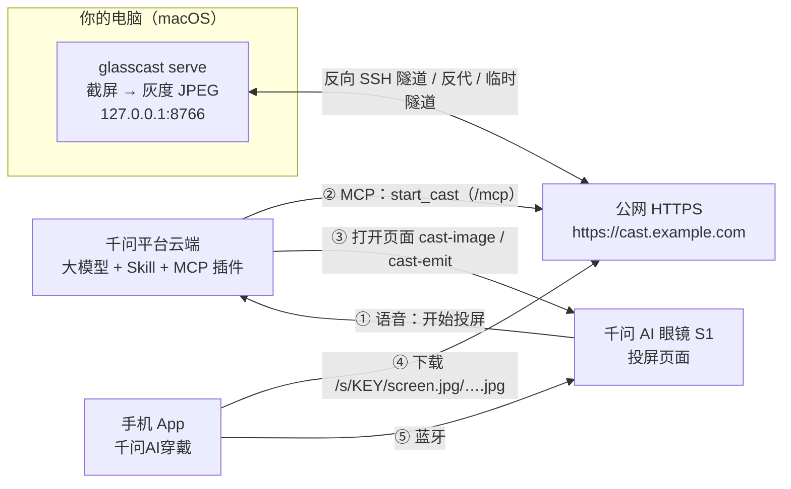

# 使用手册

这里是 glasscast 的完整说明。想先了解项目，看 [README](../README.md)。

## 目录

1. [能做什么、做不到什么](#1-能做什么做不到什么)
2. [工作原理](#2-工作原理)
3. [需要准备什么](#3-需要准备什么)
4. [五分钟本地试用](#4-五分钟本地试用不需要眼镜也不需要屏幕录制权限)
5. [完整部署清单](#5-完整部署清单)
6. [用语音控制](#6-用语音控制)
7. [参考：命令行、环境变量、HTTP 接口、MCP 工具](#7-参考)
8. [安全](#8-安全)
9. [常见问题与排错](#9-常见问题与排错)
10. [开发与测试](#10-开发与测试)
11. [项目结构与文档索引](#11-项目结构与文档索引)
12. [已知问题与 TODO](#12-已知问题与-todo)

## 1. 能做什么、做不到什么

下面是 2026 年 10 月在千问 AI 眼镜 S1 真机上测到的情况，不是理论值：

| 项目 | 实际情况 |
|---|---|
| 普通模式（默认） | 约每秒 1 张，最稳。适合看代码、文档、终端 |
| 流畅模式 | 帧率设置不等于实际张数：默认设置 4 时真机每张图间隔约 630～720 ms，约每秒 1.5 张，**这是实测的稳定上限**；设置 ≤ 2 时都约每秒 1 张（见 [§12](#12-已知问题与-todo)）；设到 4.5 以上有时会进入「卡住」状态（换图太快，没有一张能加载完，画面冻住，要重开页面或调低帧率） |
| 延迟 | 约 1～2 秒 |
| 每张图的固定开销 | 约 0.65 秒（手机下载 → 蓝牙传给眼镜 → 解码），和 2.5～4 KB 的图片体积关系不大，所以最好也就每秒 1.5～2 张 |
| 显示 | 单色绿屏，没有颜色；亮的地方发光，黑的地方透明 |
| 画布 | 页面画布 640×290 像素，由系统放在视野**左上角**，页面没法把它居中 |
| 清晰度 | 整块屏幕缩到 480×218 后小字看不清；看代码、终端时建议只投一块区域（`GLASSCAST_REGION`） |
| 声音、操作 | 只有画面，没有声音；只能看，不能在眼镜上操作电脑 |
| 电脑系统 | 只在 macOS 上测过；Linux / Windows 没测过 |
| 网络 | 平台云端和手机都必须能访问你的公网 HTTPS 域名（真证书）；平台调用工具的超时约 3 秒 |

## 2. 工作原理



一次投屏的过程：

1. 你对眼镜说「开始投屏」。平台按你的 Skill（[`skill/SKILL.md`](../skill/SKILL.md)）让大模型调用 MCP 插件的 `start_cast`。
2. 平台云端经公网 HTTPS 调用电脑上的 `/mcp`（Streamable HTTP、无状态、Bearer Token）。glasscast 开始截屏，返回图片地址 `https://cast.example.com/s/<KEY>/screen.jpg`。
3. 大模型按 SKILL.md 调用平台内置的「UI 页面渲染」工具，打开投屏页面：普通模式 [`pages/cast-image`](../pages/cast-image/template.xml)，流畅模式 [`pages/cast-emit`](../pages/cast-emit/template.xml)。
4. 页面自己不断换图片地址（`…/screen.jpg/<会话>_<序号>.jpg`），手机 App 每次下载一张最新截图。**MCP 只管开始、停止和查询，不参与逐帧刷新。**
5. 手机经蓝牙把图片送到眼镜，眼镜解码显示。

几个关键点（都是真机踩出来的）：

- **图片地址必须以 `.jpg` 结尾**。用 `?ts=` 查询串防缓存的地址能下载，但眼镜不显示，所以缓存破坏放在路径里。
- **页面每刷新一次绑定，都会让还没加载完的 `<image>` 从头加载**。所以两次换图之间页面不能有任何刷新。
- 普通模式：`<tick>` 每秒改一次图片地址，稳定每秒 1 张。
- 流畅模式：页面给自己发 `emit://` 事件倒数，每换一张图倒数 `hops × 3` 步（真机每步约 13 ms），倒数期间不写 `data`、不刷新绑定。`hops` 由 `start_cast` 按帧率算出来、经页面的 `dataSource` 下发。
- 平台把 MCP 出参只当 `content[0].text` 交给大模型，`ui_schema.json` 的 Hook 在真机上不会触发，所以页面由大模型调用渲染工具打开，[`skill/ui_schema.json`](../skill/ui_schema.json) 是 `[]`。

## 3. 需要准备什么

| 东西 | 说明 |
|---|---|
| 千问 AI 眼镜 S1 + 手机 App「千问AI穿戴」 | 眼镜已绑定到你的账号 |
| 千问 AI 硬件开放平台账号 | <https://device.qianwen.com>，能创建 MCP 插件和技能，能做真机测试 |
| macOS 电脑 | 截屏用 [mss](https://github.com/BoboTiG/python-mss)；需要给终端「屏幕录制」权限。投屏期间电脑不能锁屏或睡眠（锁屏只能截到黑屏） |
| [uv](https://docs.astral.sh/uv/) | 管理 Python 3.12 和依赖（没装 Python 3.12 时 uv 会自动下载） |
| 一个公网 HTTPS 域名 | 指向电脑上的 glasscast，必须是真证书（例如 Let's Encrypt）。平台云端和手机都要能访问，本机 `127.0.0.1` 对它们不可见。做法见 [docs/deploy.md](deploy.md)：一台 VPS + 反向 SSH 隧道（推荐），或 cloudflared 临时隧道（只适合测试） |
| 建议：mozjpeg | `brew install mozjpeg`。同样观感下 JPEG 小约 15～25%（见 docs/research.md §9.21）；文字很密时差距更大，Pillow 更容易超出 2.6 KB。没装就用 Pillow |

## 4. 五分钟本地试用（不需要眼镜，也不需要屏幕录制权限）

`--source synthetic` 用合成画面（时间戳 + 递增计数器 + 移动色块）代替截屏，能把 HTTP 和 MCP 全部跑一遍。`uv sync` 会建好 `.venv`（Python 3.12）并装好依赖：

```bash
git clone https://github.com/Edint386/glasscast.git
cd glasscast
uv sync
uv run glasscast --help
```

终端 1：启动服务（这里临时指定 token 和 key，方便下面直接复制命令）

```bash
GLASSCAST_TOKEN=local-test-token-123456 GLASSCAST_CAST_KEY=localtest123 \
  uv run glasscast serve --source synthetic --public-url http://127.0.0.1:8766 --autostart image
```

启动时会打印图片地址、MCP 地址和当前参数，并提醒「public_url 是本机地址」「画布 640×290 上真机要改成 480x218」——本地试用可以忽略。启动要等几秒到十几秒（预生成占位图），看到 `Uvicorn running on http://127.0.0.1:8766` 就好了。

终端 2：验证。先设好下面几段共用的变量，之后一直用这个终端：

```bash
B=http://127.0.0.1:8766; KEY=localtest123; TOKEN=local-test-token-123456
MCP=(-H "Authorization: Bearer $TOKEN" -H 'Content-Type: application/json' -H 'Accept: application/json, text/event-stream')
```

HTTP：第一条输出 `ok`；第二条打印 `X-Glasscast-*` 响应头并把图片存到 `/tmp`，第三条打开它（640×290 的灰度合成画面）；第四条用了错误的 key，输出 `404`。

```bash
curl -s $B/healthz; echo
curl -s -o /tmp/glasscast-screen.jpg -D - "$B/s/$KEY/screen.jpg/1_1.jpg" | grep -i x-glasscast
open /tmp/glasscast-screen.jpg
curl -s -o /dev/null -w '%{http_code}\n' "$B/s/wrongkey123/screen.jpg"
```

MCP：第一条应打印 `['start_cast', 'stop_cast', 'cast_status']`；第二、三条开始流畅模式投屏并查询状态；第四条没带 token，输出 `401`。

```bash
curl -s -X POST $B/mcp "${MCP[@]}" -d '{"jsonrpc":"2.0","id":1,"method":"tools/list","params":{}}' \
  | python3 -c 'import json,sys; print([t["name"] for t in json.load(sys.stdin)["result"]["tools"]])'
curl -s -X POST $B/mcp "${MCP[@]}" -d '{"jsonrpc":"2.0","id":2,"method":"tools/call","params":{"name":"start_cast","arguments":{"mode":"fast","fps":4}}}'; echo
curl -s -X POST $B/mcp "${MCP[@]}" -d '{"jsonrpc":"2.0","id":3,"method":"tools/call","params":{"name":"cast_status","arguments":{}}}'; echo
curl -s -o /dev/null -w '%{http_code}\n' -X POST $B/mcp -H 'Content-Type: application/json' \
  -d '{"jsonrpc":"2.0","id":4,"method":"tools/list","params":{}}'
```

不重启改流畅模式帧率，再看当前模式、帧率、色彩、画布：

```bash
GLASSCAST_TOKEN=$TOKEN uv run glasscast set-fps 2
GLASSCAST_TOKEN=$TOKEN uv run glasscast config
```

想看连续画面：这时先别停止投屏，用浏览器打开 <http://127.0.0.1:8766/s/localtest123/screen.jpg>，每刷新一次就是新的一帧。看完再运行 `stop_cast`：

```bash
curl -s -X POST $B/mcp "${MCP[@]}" -d '{"jsonrpc":"2.0","id":5,"method":"tools/call","params":{"name":"stop_cast","arguments":{}}}'; echo
```

`stop_cast` 之后再刷新浏览器，就变成「投屏已停止」占位图。回到终端 1 按 `Ctrl-C` 退出。

想看页面在官方渲染内核里的效果（不用眼镜、不用登录平台），见 [tools/simulator/README.md](../tools/simulator/README.md)。

## 5. 完整部署清单

按顺序做，每一步做完再往下：

1. **安装**

   ```bash
   git clone https://github.com/Edint386/glasscast.git /Users/you/glasscast
   cd /Users/you/glasscast
   uv sync
   ```

   建议再装 mozjpeg（可选，没装就用 Pillow，见 [§3](#3-需要准备什么)）：

   ```bash
   brew install mozjpeg
   ```

2. **给终端屏幕录制权限**。权限是授给**启动 glasscast 的那个程序**（Terminal、iTerm、VS Code……）的：

   ```bash
   uv run glasscast snapshot test.jpg && open test.jpg
   ```

   第一次会弹出系统授权框。到 **系统设置 → 隐私与安全性 → 屏幕录制** 打开对应终端的开关，**完全退出并重新打开这个终端**，再截一次。截到黑屏或只有桌面壁纸、没有窗口，说明权限还没生效。

3. **写配置**。复制模板，再生成一个 token，把输出填到 `.env` 的 `GLASSCAST_TOKEN=` 后面：

   ```bash
   cp .env.example .env
   openssl rand -hex 24
   ```

   编辑 `.env`：`GLASSCAST_PUBLIC_URL` 改成你的域名，填上 `GLASSCAST_TOKEN`。用反向 SSH 隧道时，再取消 `.env` 末尾 `GLASSCAST_TUNNEL_HOST`、`GLASSCAST_TUNNEL_USER` 的注释并改成你的服务器。[`.env.example`](../.env.example) 里已经写好了真机验证过的画面参数，建议不要改：

   | 变量 | 推荐值 | 为什么 |
   |---|---|---|
   | `GLASSCAST_CANVAS` | `480x218` | 代码默认的 640×290 + 质量 70 的图太大，真机下载成功却不显示 |
   | `GLASSCAST_COLOR_MODE` | `gray` | 屏幕是单色绿，灰度图更小 |
   | `GLASSCAST_FIT_MODE` | `crop` | 居中裁剪铺满，不留黑边（Mac 屏幕比画布高，上下会裁掉一部分） |
   | `GLASSCAST_JPEG_QUALITY` + `GLASSCAST_JPEG_TARGET_KB` | `90` + `2.6` | 尽量不超过约 2.6 KB（质量下限 10，文字很密时会超过；没装 mozjpeg 时超得更多），在这个体积内取最高质量 |
   | `GLASSCAST_JPEG_ENCODER` | `auto` | 装了 mozjpeg 就用它，否则用 Pillow |
   | `GLASSCAST_FAST_FPS` | `4` | 流畅模式的稳定上限（真机约每秒 1.5 张） |

   glasscast 不会自己读 `.env`，每次启动前用 `. ./.env` 载入（下面的命令都这样写）。

4. **把服务暴露到公网 HTTPS**：按 [docs/deploy.md](deploy.md) 选一种：
   - **反向 SSH 隧道 + VPS（推荐）**：VPS 上的 nginx / OpenResty（也支持 1Panel）+ Let's Encrypt 证书，用 `deploy/server-setup.sh` 部署；电脑用 `deploy/tunnel.sh` 开反向 SSH 隧道。
   - **挂在已有站点的路径前缀下**：例如 `https://app.example.com/cast`，隧道相同，只是入口不同。
   - **cloudflared 临时隧道**：只适合测试，地址每次都变，而且会把整个端口暴露出去，包括本机管理接口。

   要求：真证书；HTTP/2 没问题，但**不要对外声明 HTTP/3**（响应头里不要有 `alt-svc: h3`）；公网上的 `/admin/` 返回 404（`deploy/` 里的反代配置已经这样做了；cloudflared 临时隧道没有这条规则，只靠 Token，见 [§8](#8-安全)）。服务器离你和平台越近越好，平台调用工具只等约 3 秒。

5. **启动**（两个终端）。终端 1 启动投屏服务：

   ```bash
   . ./.env && uv run glasscast serve
   ```

   终端 2 开反向 SSH 隧道，`--keep-awake` 同时阻止电脑空闲睡眠：

   ```bash
   . ./.env && ./deploy/tunnel.sh --keep-awake
   ```

   `tunnel.sh` 连哪台服务器由 `.env` 里的 `GLASSCAST_TUNNEL_HOST` / `GLASSCAST_TUNNEL_USER` 决定，也可以用 `-H`、`-u` 指定（`./deploy/tunnel.sh --help`）。

   `--public-url`（或 `GLASSCAST_PUBLIC_URL`）必须和平台访问的域名完全一致：它决定工具返回的图片地址，也决定 MCP 放行哪个 `Host`，不一致平台会收到 421。

6. **从外网验证**（最好用手机热点之类的外部网络）。第一条 `curl` 应输出 `HTTP/2 200`；第二条查 `alt-svc`，应该没有输出；第三条带 token 列工具，应返回一段 JSON（这里只显示开头 300 字节）：

   ```bash
   . ./.env
   curl -sI https://cast.example.com/healthz | head -1
   curl -sI https://cast.example.com/healthz | grep -i alt-svc
   curl -s -X POST https://cast.example.com/mcp -H "Authorization: Bearer $GLASSCAST_TOKEN" \
     -H 'Content-Type: application/json' -H 'Accept: application/json, text/event-stream' \
     -d '{"jsonrpc":"2.0","id":1,"method":"tools/list","params":{}}' | head -c 300; echo
   ```

7. **在开放平台上配置**：按 [docs/platform-setup.md](platform-setup.md) 一步步做，概括起来是：
   1. 新建 MCP 插件：地址 `https://cast.example.com/mcp`，传输协议选**无状态**，认证方式 Bearer Token，填 `.env` 里的 `GLASSCAST_TOKEN`（只填 token 本体）。刷新工具，应看到 `start_cast`、`stop_cast`、`cast_status`。插件编码（6 个字符）在技能编辑器里取得，见 [platform-setup 第 7.2 步](platform-setup.md#72-找到你的插件编码)。
   2. 新建技能（Skill），创建两个页面 `cast-image`、`cast-emit`，分别粘贴 `pages/<页面名>/template.xml` 和 `data.json`。
   3. 粘贴 [`skill/SKILL.md`](../skill/SKILL.md)，把里面 3 处 `XXXXXX`（`^^XXXXXX.start_cast^^` 等）换成你的插件编码；`^^tQ8fCF.ui_page_render^^` 是平台内置的「UI 页面渲染」工具，原样保留。
   4. `ui_schema.json` 保持 `[]`。
   5. 预览、沙箱调试、真机测试，最后以「个人私有」范围发布到自己的眼镜。**Token 不要写进 SKILL.md、页面或 data.json，也不要把含密钥的技能发布到公开市场。**

8. **对眼镜说「开始投屏」**。看到画面后试试「用流畅模式投屏」「投屏状态」「停止投屏」。

## 6. 用语音控制

对眼镜说（Skill 里列了更多说法）：

| 你说 | 发生什么 | 眼镜回答 |
|---|---|---|
| 「开始投屏」「把电脑投到眼镜上」 | `start_cast(mode=image)`，打开 `cast-image`，约每秒 1 张 | 投屏已开始 |
| 「用流畅模式投屏」「投屏流畅一点」 | `start_cast(mode=fast)`，打开 `cast-emit` | 已用流畅模式投屏 |
| 「换成普通模式」「省流量投屏」 | 切回普通模式 | 已换成普通模式 |
| 「投屏调到 N 帧」「每秒 N 张」 | `start_cast(mode=fast, fps=N)`，带新的 `hops` 重新打开 `cast-emit`；N 取 1～10，可以带小数 | 已调到每秒 N 张 |
| 「快一点」「慢一点」 | 先查当前帧率，再加减 1：「快一点」最多到 4，「慢一点」最低到 1 | 已调到每秒 N 张 |
| 「最流畅」「最快」「最省流量」 | 帧率设置直接调到 4（前两个）或 1（最省流量） | 已调到每秒 N 张 |
| 「投屏状态」「投屏还在吗」「现在每秒几张」 | `cast_status` | 例如「正在投屏，普通模式，画面刚刚更新」 |
| 「停止投屏」「别投了」 | `stop_cast`：电脑停止截屏，页面显示「投屏已停止」 | 投屏已停止 |

- 这里的 N 都是**帧率设置**，不是实际张数：设置 4 时真机约每秒 1.5 张（N ≤ 2 时都约每秒 1 张，见 [§12](#12-已知问题与-todo)）。**建议用 4 或更低**：4 是实测的稳定上限，所以「最流畅」「最快」「快一点」最多只调到 4。只有明确说出更大的数字（例如「投屏调到 6 帧」）才会超过它，设到 4.5 以上可能画面卡住，这时说「投屏调到 4 帧」。
- 停止投屏不会关掉眼镜上的页面，用眼镜正常的返回手势离开即可。
- 电脑上也能调帧率：`. ./.env && uv run glasscast set-fps 2`。电脑端截帧立即生效，但眼镜上**已经打开**的流畅模式页面要等下一次 `start_cast`（说「投屏调到 2 帧」）重新打开后才按新节拍换图。运行中改的值在重启 `glasscast serve` 后回到 `GLASSCAST_FAST_FPS`。

## 7. 参考

以下内容按代码（`glasscast/cli.py`、`config.py`、`server.py`、`mcp_tools.py`）整理；有出入时以 `uv run glasscast <子命令> --help` 为准。

### 7.1 命令行

```text
glasscast serve      启动 HTTP + MCP 服务（一个进程一个端口）
glasscast snapshot   截一张并按画布处理后保存，用来调画布、区域和画质
glasscast monitors   列出显示器坐标（给 --monitor / --region 用）
glasscast set-fps    不重启地修改正在运行的 serve 的流畅模式帧率（调本机 POST /admin/fps）
glasscast config     查看正在运行的 serve 的当前配置（调本机 GET /admin/config）
glasscast fset       .fset 帧合集工具 build / inspect / extract（研究用）
glasscast --version
```

#### `glasscast serve`

优先级：**命令行 > 环境变量 > 默认值**；环境变量为空字符串时视为没设置。「推荐」一列是真机用的值（已写在 `.env.example` 里）。

| 参数 | 环境变量 | 默认 | 推荐 | 说明 |
|---|---|---|---|---|
| `--public-url URL` | `GLASSCAST_PUBLIC_URL` | **必填** | 你的域名 | 对外 HTTPS 根地址，末尾不要 `/`，不能带 `?` 或 `#`；可以带路径前缀（如 `https://app.example.com/cast`） |
| `--host HOST` | `GLASSCAST_HOST` | `127.0.0.1` | | 监听地址。经隧道 / 反代访问，不要改成 `0.0.0.0` |
| `--port PORT` | `GLASSCAST_PORT` | `8766` | | 监听端口（`deploy/tunnel.sh` 默认把服务器的 18766 转发到这里） |
| `--token TOKEN` | `GLASSCAST_TOKEN` | 自动生成 | 固定一个 | MCP 和本机管理接口的 Bearer Token，只能是可见 ASCII，建议 ≥ 16 位。自动生成时只打印一次、重启就变。建议只用环境变量（命令行参数会出现在进程列表里） |
| `--cast-key KEY` | `GLASSCAST_CAST_KEY` | 每次启动随机 16 位 | 留空 | 图片地址 `/s/<KEY>/…` 里的随机段，8～128 位字母、数字、`-`、`_` |
| `--source screen\|synthetic` | `GLASSCAST_SOURCE` | `screen` | | `synthetic` 是合成画面，不需要屏幕录制权限 |
| `--monitor N` | `GLASSCAST_MONITOR` | `1` | | mss 显示器下标：1 = 主屏，0 = 所有显示器拼在一起 |
| `--region L,T,W,H` | `GLASSCAST_REGION` | 全屏 | 按需 | 只截一块区域，相对所选显示器左上角，macOS 为逻辑点；`none` = 全屏 |
| `--fit fit\|crop` | `GLASSCAST_FIT_MODE` | `fit` | `crop` | `fit` 等比缩放加黑边；`crop` 居中裁剪铺满 |
| `--canvas WxH` | `GLASSCAST_CANVAS` | `640x290` | `480x218` | 输出画布。≥ 640×290 时启动会提醒（真机不显示） |
| `--jpeg-quality Q` | `GLASSCAST_JPEG_QUALITY` | `70` | `90` | JPEG 质量 1～100；设了 `--jpeg-target-kb` 时是质量上限 |
| `--jpeg-target-kb KB` | `GLASSCAST_JPEG_TARGET_KB` | `0`（固定质量） | `2.6` | 每张图尽量不超过这么多 KB，二分搜索能做到的最高质量；质量下限 10，压不到时会超过（0～1024） |
| `--jpeg-encoder auto\|mozjpeg\|pillow` | `GLASSCAST_JPEG_ENCODER` | `auto` | `auto` | `auto`：找到 mozjpeg 就用它，否则用 Pillow |
| `--color gray\|rgb` | `GLASSCAST_COLOR_MODE` | `gray` | `gray` | 输出色彩。`rgb` 只作对照，眼镜显示不出颜色 |
| `--image-fps F` | `GLASSCAST_IMAGE_FPS` | `1` | | 普通模式截帧频率。页面每秒只拉一次，调高只能让拉到的画面更新一点，代价是 CPU；大于 2 时启动会提醒 |
| `--fast-fps F` | `GLASSCAST_FAST_FPS` | `4` | `4` | 流畅模式帧率设置的**初始值**，1～10，可带小数，超出启动报错。真机实际约为它的一半张/秒。运行中可用 `start_cast(fps=…)` 或 `glasscast set-fps` 修改 |
| `--emit-hop-ms MS` | `GLASSCAST_EMIT_HOP_MS` | `20` | | 流畅模式页面每一跳的估计毫秒数（5～500）。`start_cast` 下发 `hops = round(1000 / fast_fps / MS)`，限制在 1～25 |
| `--gif-levels 0\|2\|4\|8\|16` | `GLASSCAST_GIF_LEVELS` | `0`（关闭） | | **实验**：每帧另出一张这么多级灰度的 GIF（`…/screen.jpg/<任意>.gif`） |
| `--gif-delay-ms MS` | `GLASSCAST_GIF_DELAY_MS` | `100` | | **实验**：GIF 帧时长，0～655350 之间 10 的倍数 |
| `--autostart off\|image\|fast` | `GLASSCAST_AUTOSTART` | `off` | | 启动后立即开始采集，不等 `start_cast` |
| `--allowed-host HOST`（可重复） | `GLASSCAST_ALLOWED_HOSTS`（逗号分隔） | 无 | | MCP 额外放行的 `Host` 头。public-url 的主机和本机回环已自动放行；命令行和环境变量的会合并 |
| `--no-dns-rebinding-protection` | `GLASSCAST_DNS_REBINDING_PROTECTION=0` | 开启 | | 关闭 MCP 的 Host / Origin 校验，只在反代改写了 Host 又改不了时用 |
| `--log-level LEVEL` | 无 | `info` | | `debug` / `info` / `warning` / `error` |
| `--no-access-log` | 无 | 打印 | | 默认每个请求一行访问日志（路径里的 key 打码成 `…`，时间戳到毫秒） |
| `--no-probe` | 无 | 试截 | | 默认启动时试截一张，用来提前触发权限弹窗、发现黑屏 |

`Ctrl-C` 或 `SIGTERM` 优雅退出（返回码 0）。

#### 其他子命令

下面是各子命令的写法，方括号里是可选参数，不能直接粘贴运行：

```text
uv run glasscast snapshot OUT.jpg [--source …] [--monitor N] [--region L,T,W,H] [--fit fit|crop] \
    [--canvas WxH] [--jpeg-quality Q] [--jpeg-target-kb KB] [--jpeg-encoder …] [--color gray|rgb] [--raw]
uv run glasscast monitors [--json]
uv run glasscast set-fps FPS [--host H] [--port N] [--token T] [--json]
uv run glasscast config [--host H] [--port N] [--token T] [--json]
uv run glasscast fset build OUT.fset IMG... [--canvas WxH] [--fit fit|crop] [--format png|jpeg|raw] [--jpeg-quality Q]
uv run glasscast fset inspect FILE.fset [--json] [--frames] [--no-strict]
uv run glasscast fset extract FILE.fset OUTDIR [--prefix frame_] [--no-strict]
```

- `snapshot`：截一张、按画布和色彩处理后保存（扩展名 `.png` 存 PNG，其余存 JPEG），打印尺寸、字节数和预算提醒。也读取同名的 `GLASSCAST_*` 环境变量，所以 `. ./.env && uv run glasscast snapshot t.jpg` 得到的就是眼镜上的画面。`--raw` 保存未缩放的原始截屏，用来量 `--region` 坐标。
- `monitors`：列出显示器坐标（下标 0 是所有显示器的并集，1 是主屏）。macOS 是逻辑点，Retina 实际截图约 2 倍像素。
- `set-fps`：FPS 取 1～10，可带小数（例如 2.5）。本地先校验，超出范围直接报错。
- `config`：当前模式、流畅 / 普通模式帧率、帧时长、色彩、画布。
- `set-fps` 和 `config` 都只连本机：`--host` 默认读 `GLASSCAST_HOST` 再默认 `127.0.0.1`，`--port` 默认读 `GLASSCAST_PORT` 再默认 `8766`，`--token` 默认读 `GLASSCAST_TOKEN`（先 `. ./.env`）。
- `fset`：`.fset` 帧合集（`<frame-set>` 用的文件格式，见 [docs/research.md](research.md)）的打包、查看、拆帧。正常投屏用不到。

返回码：0 成功；1 运行失败（截屏失败、文件读不了、连不上 glasscast、Token 不对等）；2 参数或配置错误（包括帧率超出 1～10）；3 启动失败（最常见的是端口被占用：`address already in use`，先停掉已有的 glasscast 或换 `--port`）。

### 7.2 环境变量

- `glasscast serve` 的每个参数（`--log-level`、`--no-access-log`、`--no-probe` 除外）都对应一个 `GLASSCAST_<字段名大写>` 环境变量，见上表。`snapshot` 读其中的截屏和画面参数，`set-fps` / `config` 读 `GLASSCAST_HOST`、`GLASSCAST_PORT`、`GLASSCAST_TOKEN`。
- 格式：`GLASSCAST_CANVAS=480x218`（也接受 `480×218`、`480,218`）；`GLASSCAST_REGION=0,0,1280,580`（`none` / `full` = 全屏）；布尔值接受 `1/0`、`true/false`、`yes/no`、`on/off`；`GLASSCAST_ALLOWED_HOSTS` 用逗号或空格分隔。
- `GLASSCAST_MOZJPEG`：mozjpeg 的 `cjpeg` 路径。不设时查 Homebrew 的默认位置（`/opt/homebrew/opt/mozjpeg/bin/cjpeg`、`/usr/local/opt/mozjpeg/bin/cjpeg`）。
- `deploy/tunnel.sh` 另外读 `GLASSCAST_TUNNEL_HOST`、`GLASSCAST_TUNNEL_USER`、`GLASSCAST_TUNNEL_SSH_PORT`、`GLASSCAST_LOCAL_PORT`、`GLASSCAST_REMOTE_PORT`、`GLASSCAST_WARM_INTERVAL`、`GLASSCAST_WARM_RESOLVE`（说明见 [`.env.example`](../.env.example) 和 `./deploy/tunnel.sh --help`）。
- 完整模板：[`.env.example`](../.env.example)。

### 7.3 HTTP 接口

| 方法和路径 | 说明 |
|---|---|
| `GET /healthz` | `200 ok` |
| `GET /s/{key}/screen.jpg` | 最新一张 JPEG（普通和流畅模式共用）；没有画面时返回同尺寸的占位图 |
| `GET /s/{key}/screen.jpg/{stamp}` | 同上，`stamp` 任意。页面用 `…/screen.jpg/<会话>_<序号>.jpg`：地址必须以 `.jpg` 结尾眼镜才显示 |
| `GET /s/{key}/status.json` | 采集统计 + 当前地址 + 页面参数 + 启动配置，不含 token。顶层 `fast_fps` 是运行中的当前值 |
| `POST /mcp` | MCP（见下节）。`GET /mcp` 带正确 token 时返回 405（无状态，只用 POST），不带 token 返回 401 |
| `POST /admin/fps` | 本机管理接口：请求体 `{"fps": 2}`，不重启改流畅模式帧率。Bearer Token 同 `/mcp` |
| `GET /admin/config` | 本机管理接口：当前模式、帧率、帧时长、`hops`、色彩、画布。Bearer Token 同 `/mcp` |
| `GET /s/{key}/timer.fset` | 参考页面 `pages/cast-fast` 用的定时器（内容固定的 2 帧 8×8 PNG `.fset`）。该页面只能在本地模拟器里跑 |
| `GET /s/{key}/clip.fset`、`GET /s/{key}/clip/{n}.fset` | **实验**：已下线的 clip 分段流，平时返回占位段 |
| `GET /s/{key}/screen.jpg/{stamp}.gif` | **实验**：同一帧的灰度 GIF，只在 `--gif-levels` 大于 0 时有，否则 404 |
| `GET /s/{key}/screen.jpg/probe/{file}` | **实验**：真机下载探针用的固定测试文件（`.fset` / `.gif` / `.jpg`，命名规则见 `glasscast/probe.py`） |

- key 不对一律 `404 Not Found`（和路径不存在一样），响应和访问日志里都不出现 key。
- query string 一律忽略。所有响应都带 `Cache-Control: no-store`、`Access-Control-Allow-Origin: *`、`Cross-Origin-Resource-Policy: cross-origin`（后两个给本地模拟器用）。
- `screen.jpg` 的响应头：`ETag`、`X-Glasscast-Seq`（递增序号，0 = 占位）、`X-Glasscast-Age`（画面已过去的秒数）、`X-Glasscast-Mode`；占位图另有 `X-Glasscast-Placeholder`（`not_started` / `waiting` / `stopped`）。
- 占位图：从没开始过是「投屏未开始」，刚开始还没截到是「等待画面…」，`stop_cast` 之后是「投屏已停止」（停止时会清掉最后一帧，地址再也取不到停止前的画面）。

### 7.4 MCP 工具

- 传输：Streamable HTTP，**无状态 + JSON 响应**，挂在 `/mcp`；不先 `initialize` 直接 `tools/call` 也行。平台插件选「无状态」协议。
- 认证：`Authorization: Bearer <token>`，不对返回 401。平台 Token 栏误填成 `Bearer xxx` 也能通过（日志里提示一次）。
- Host 校验：放行 public-url 的主机（带不带端口都行）、`127.0.0.1` / `localhost` / `[::1]`、`--allowed-host`；其他 `Host` 返回 421。
- 返回值都是 JSON 对象，同时放在 `structuredContent` 和 `content[0].text` 里（`tools/list` 里有逐字段的 `outputSchema`）。失败时 `success: false`，`message` 是一句可以直接念给用户的中文，技术细节在 `error`。
- 所有工具都在 1 秒内返回：`start_cast` 切换模式后最多等第一帧 0.6 秒，其余不阻塞。

| 工具 | 参数 | 返回 |
|---|---|---|
| `start_cast` | `mode`：`image`（默认，普通模式）或 `fast`（流畅模式），也接受「普通」「流畅」「视频」等说法；`fps`（可选，number 或 null）：流畅模式帧率设置，1～10，可带小数，只对 `fast` 生效 | `success`、`message`、`mode`（实际模式）、`url`（页面拉取的图片地址）、`width`、`height`、`hops`（流畅模式页面每换一张图的跳数，1～25）、`fps` / `fast_fps`（生效的帧率设置）、`page_fps`（按 `hops` 估算的速率）、`frame_duration_ms`、`timer_url`（后两个给参考页面用）、`previous_mode`、`first_frame` |
| `stop_cast` | 无 | `success`、`message`、`previous_mode`。重复调用也安全 |
| `cast_status` | 无 | `success`、`message`、`active`、`mode`（`off` / `image` / `fast`）、`last_frame_age_s`、`seq`、`frames_captured`、`capture_fps`、`consecutive_errors`、`errors`、`last_error`、`fast_fps`、`fast_frame_duration_ms`、`frame_duration_ms`、`clip_frames` |

`start_cast(mode="fast", fps=4)` 的返回示例（推荐配置）：

```json
{"success": true, "message": "投屏已开始（流畅模式），每秒约 4 帧", "mode": "fast",
 "url": "https://cast.example.com/s/<KEY>/screen.jpg",
 "timer_url": "https://cast.example.com/s/<KEY>/timer.fset",
 "width": 480, "height": 218, "frame_duration_ms": 125,
 "fps": 4.0, "fast_fps": 4.0, "hops": 12, "page_fps": 4.2,
 "previous_mode": "off", "first_frame": true}
```

（`message` 里的「每秒约 4 帧」和 `page_fps` 都是按旧的换算估的，真机约每秒 1.5 张，见 [§12](#12-已知问题与-todo)。）

成功后大模型按 SKILL.md 打开页面：普通模式 `ui_page_render(templateName="cast-image", dataSource={"url": …})`，流畅模式 `templateName="cast-emit"`、`dataSource` 带 `url` 和 `hops`。`fps` 不合法时什么都不改，返回 `success: false` 和「帧率只能调到每秒 1 到 10 张……」。`start_cast` 第一帧就截屏失败（多半是没有屏幕录制权限）时会停止采集并返回 `success: false`。

## 8. 安全

- **图片地址里的 KEY 等于看屏口令**：拿到完整地址的人就能看到你的屏幕。眼镜发不了请求头，图片只能靠它保护。不要外传地址；地址会经过千问平台（工具出参、页面数据），所以 KEY 不建议长期固定（默认每次启动都换）。怀疑泄露就重启 glasscast（固定了 KEY 的话换一个新的）。
- **Token** 只填在平台的插件配置和本机的 `.env` 里。不要写进 SKILL.md、页面或 data.json，不要提交到 git（`.env` 已在 `.gitignore` 里），不要把含密钥的技能发布到公开市场；技能用「个人私有」范围发布。
- glasscast 默认只监听 `127.0.0.1`。来自环境变量的 token 不会打印；访问日志里 key 打码，不记录 Authorization 头（会记录 User-Agent 和来源 IP）。反代的错误日志可能含 key，见 [docs/deploy.md](deploy.md)。
- 本机管理接口 `/admin/fps`、`/admin/config` 用同一个 token；`deploy/` 里的反代配置让公网上的 `/admin/` 返回 404。cloudflared 临时隧道会把整个端口暴露出去，那时只靠 token 保护。
- 投屏的是你屏幕上的一切，包括弹出的通知和密码框。用 `GLASSCAST_REGION` 只投需要的区域，不用时说「停止投屏」。
- 发现安全问题时请不要在公开 issue 里写细节，可以先开一个不含细节的 issue 约私下联系的方式。

## 9. 常见问题与排错

| 现象 | 原因和处理 |
|---|---|
| 平台刷新插件工具数为 0，或调试时报错 | 公网 HTTPS 不通、证书不对、token 不一致（401）、Host 不在放行列表（421）、响应头带了 `alt-svc: h3`。先按 [§5](#5-完整部署清单) 第 6 步从外网 curl 一遍 |
| `/mcp` 返回 421 | `GLASSCAST_PUBLIC_URL` 和平台访问的域名不一致；或者反代改写了 Host，用 `--allowed-host` 补上 |
| `/mcp` 返回 401 | 插件里的 token 和 `GLASSCAST_TOKEN` 不一致；没固定 token 时每次重启都会变 |
| 眼镜说「电脑上的投屏程序没有响应」 | 平台调用工具约 3 秒超时。SKILL.md 会让模型自动重试一次；经常出现说明链路太慢：服务器尽量近，用 `deploy/tunnel.sh` 的保温（默认每 30 秒一次），确认 glasscast 和隧道都在跑 |
| 说了「开始投屏」但眼镜上没出现页面 | 页面是大模型调用渲染工具打开的：检查 SKILL.md 里的 `XXXXXX` 是否都换成了你的插件编码、`^^tQ8fCF.ui_page_render^^` 有没有被改，两个页面名是否正好是 `cast-image`、`cast-emit` |
| 页面打开了，但一直是黑的 | 图太大（用 `.env.example` 里的推荐参数：480×218、约 2.6 KB）；看 glasscast 访问日志里有没有 `screen.jpg/…jpg` 请求、状态码是不是 200 |
| 画面是「等待画面…」、黑屏或只有桌面壁纸 | 没有屏幕录制权限（[§5](#5-完整部署清单) 第 2 步），或电脑锁屏 / 睡眠。`uv run glasscast snapshot test.jpg` 自查，用 `--source synthetic` 对照 |
| 流畅模式画面冻住（右下角的换图编号不再增加） | 帧率设得太高，进入了「换图太快、一张都加载不完」的状态：说「投屏调到 4 帧」或更低，不行就用返回手势离开页面，再说「用流畅模式投屏」 |
| 流畅模式并不比普通模式快多少 | 正常：每张图有约 0.65 秒固定开销，真机上限约每秒 1.5 张 |
| `glasscast set-fps` 成功了，眼镜上节奏没变 | 已打开的页面在打开时就拿到了 `hops`，说「投屏调到 N 帧」让页面重新打开 |
| `set-fps` / `config` 报「连不上」或 401 | serve 没在跑、端口不对，或 token 不一致（先 `. ./.env`） |
| 停止投屏后页面还在 | 正常：页面显示「投屏已停止」，用眼镜的返回手势离开 |
| 画面在视野左上角、不居中 | S1 系统把 640×290 的页面画布放在左上角，页面改不了 |
| 字太小看不清 | 用 `GLASSCAST_REGION` 只投一块区域（`uv run glasscast monitors` 和 `snapshot --raw` 帮你量坐标） |
| 画面没有颜色 | 眼镜屏幕是单色绿，`rgb` 也显示不出颜色 |
| 启动要等十来秒 | 正常：启动时预生成占位图和探针文件 |
| `glasscast serve` 报 `address already in use` 后退出（返回码 3） | 端口被占用：先停掉已有的 glasscast，或用 `--port` 换一个端口（用 `deploy/tunnel.sh` 时加 `-l` 跟着改） |
| `glasscast serve` 报「需要 mcp 2.3 或更新的 2.x」 | 用 `uv sync` 安装、`uv run glasscast …` 运行，不要用 pip 装进已有 mcp 1.x 的环境 |

更多平台侧的问题见 [docs/platform-setup.md](platform-setup.md)，部署和隧道的问题见 [docs/deploy.md](deploy.md)。

## 10. 开发与测试

`uv sync` 会带上开发依赖 pytest。第二条跑主测试集（`tests/`），第三条跑模拟器静态服务器的测试：

```bash
uv sync
uv run pytest -q
uv run pytest -q tools/simulator/test_serve.py
```

测试不需要屏幕录制权限、不真截屏、不访问公网：画面来自合成帧源或注入的假帧源，`serve` 用 `--source synthetic` 在子进程里真起一遍。

| 测试文件 | 覆盖内容 |
|---|---|
| `tests/test_fset.py`、`test_frames.py`、`test_pipeline.py` | `.fset` 读写、缩放 / 裁剪 / 灰度 / JPEG 编码（含定体积编码、mozjpeg）、采集线程、运行中改帧率 |
| `tests/test_server.py` | 全部路由、key 校验、占位图、通用响应头、Bearer 401、Host 421、GET 405、访问日志打码、`/admin/*` |
| `tests/test_mcp.py` | 用 mcp 2.x 客户端走 initialize → tools/list → tools/call，出参 schema、模式归一化、`fps` 参数、截屏失败 |
| `tests/test_cli.py` | 子进程启动 `serve`、信号退出、配置优先级与校验、`set-fps` / `config` |
| `tests/test_pages.py` | 页面模板是良构 XML、绑定和工具出参一致、`ui_schema.json` |
| `tests/test_probe.py` | 探针文件生成 |

**本地模拟器**：`tools/simulator/` 是我们自己写的测试台，包着平台编辑器预览用的官方 waft-lite WASM 渲染内核。内核**不随仓库分发**，由 `tools/simulator/fetch_assets.sh` 在运行时从官方公开 CDN 下载。第一条把内核下载到 `tools/simulator/assets/`（已被 `.gitignore` 排除），第二条启动模拟器，然后用 Chrome / Edge 打开 <http://127.0.0.1:8770/>：

```bash
tools/simulator/fetch_assets.sh
uv run python tools/simulator/serve.py
```

它复现的是编辑器预览，不是手机 + 蓝牙那条链路：模拟器里能跑到的帧率比真机高得多，真机表现以眼镜为准。

代码结构：

| 模块 | 内容 |
|---|---|
| `glasscast/cli.py` | 命令行入口：`serve` / `snapshot` / `monitors` / `fset` / `set-fps` / `config` |
| `glasscast/config.py` | `Settings`、`load_settings()`（命令行 > 环境变量 > 默认值）、`ENV_VARS` |
| `glasscast/server.py` | Starlette 应用：图片路由、占位图、`/admin/*`、Bearer 校验中间件、访问日志 |
| `glasscast/mcp_tools.py` | 三个 MCP 工具（`CastController`）和 `build_mcp_server()` |
| `glasscast/pipeline.py` | 采集线程 `CastPipeline`：按模式截帧、编码、发布最新一帧；帧率换算 |
| `glasscast/frames.py` | 帧源（截屏 / 合成）、缩放裁剪、灰度、JPEG / PNG / GIF 编码、mozjpeg、占位图 |
| `glasscast/fset.py` | `.fset` 帧合集格式的读写 |
| `glasscast/probe.py` | 真机探针用的测试文件（实验） |

## 11. 项目结构与文档索引

```text
glasscast/                 Python 包（见上表）
pages/
  cast-image/              普通模式页面（template.xml + 预览用 data.json），上传到平台
  cast-emit/               流畅模式页面，上传到平台
  cast-fast/               帧合集定时器版的流畅页面：平台保存校验（URI-001）不放行，只能在本地模拟器里跑
skill/
  SKILL.md                 技能文件（把 XXXXXX 换成你的插件编码）
  ui_schema.json           []：Hook 在真机上不触发，页面由大模型打开
deploy/                    公网暴露：tunnel.sh、server-setup.sh、nginx 配置模板、1Panel 反代片段、证书续期、sync_lan_cert.sh
tools/
  simulator/               本地模拟器（官方内核运行时下载）
  lan_https_proxy.py       可选：在家时让手机经局域网直接从电脑取图（路由器 DNS 覆盖 + 同一张证书，用法见文件开头）
reference/                 历史实验，不用上传到平台（目录说明见 reference/README.md）
  ui-schema-hooks/         ui_schema.json 的 Hook 版本（真机不触发，留作记录）
  experiments/             已废弃的 cast_clip 页面、cast_emit 的各种真机探针页
  labserver.py             调研初期的小实验服务器
tests/                     pytest
.env.example               配置模板
```

| 文档 | 内容 |
|---|---|
| [docs/deploy.md](deploy.md) | 公网暴露：反向 SSH 隧道 + nginx / OpenResty / 1Panel、路径前缀、cloudflared 临时隧道、可选的局域网直连 |
| [docs/platform-setup.md](platform-setup.md) | 在千问 AI 硬件开放平台上建插件、技能和页面，预览、真机测试、发布 |
| [docs/research.md](research.md) | 带日期的实验记录：平台机制、页面刷新、图片预算、`.fset` 格式、模拟器和真机实测。较早的条目可能已被后面的结论推翻，当前行为以本手册和 platform-setup 为准 |
| [docs/implementation-guide.md](implementation-guide.md) | 最初的实现规格（带日期，部分设计已变） |
| [pages/README.md](../pages/README.md) | 三个眼镜页面各是什么、页面要的数据、改页面前要知道的限制 |
| [tools/simulator/README.md](../tools/simulator/README.md) | 本地模拟器用法与实测结论 |
| [reference/README.md](../reference/README.md) | 历史实验文件一览：探针页面、被淘汰的设计，以及它们对应 research.md 的哪一节 |
| [reference/ui-schema-hooks/README.md](../reference/ui-schema-hooks/README.md) | 为什么不用 Hook 打开页面 |
| [reference/experiments/cast_clip/README.md](../reference/experiments/cast_clip/README.md) | 为什么 `.fset` 分段流行不通 |
| 官方文档 | <https://device.qianwen.com/docs>（技能规范、UI 页面开发、工具接入等章节） |

## 12. 已知问题与 TODO

- **fps 换算校准**：流畅模式的「帧率」现在只是一个设置值，真机实际比它低（设 4 约每秒 1.5 张）。代码、工具描述、`message`（「每秒约 N 帧」）、`page_fps` 和 SKILL.md 的话术（「已调到每秒 N 张」）仍按旧换算 `hops = round(1000 / N / 20)` 来说，都偏高。TODO：重新标定 `emit_hop_ms` 或换算公式，让 fps 等于真机的每秒张数，并把可调范围限制在稳定区间内。
- **帧率设置 ≤ 2 时节奏相同**：帧率设置 ≤ 2 时 `hops` 都封顶 25（75 步，按每步 13 ms 估算约 1 秒），所以设置 1、1.5、2 的页面换图节奏相同，约每秒 1 张；从 2 调到 1 只减少电脑截帧，不改变眼镜上的节奏。
- **高帧率会卡住**：设到 4.5 以上有时进入画面冻住的状态。SKILL.md 已把「最流畅」「最快」「快一点」限制在 4 以内，但工具本身仍接受 1～10，用户明确说出更大的数字时照传。TODO：校准后收紧工具的上限。
- **代码默认画布在真机上不显示**：默认 640×290 + 质量 70 的图太大。目前靠 `.env.example` 的推荐值；TODO：把默认值改成真机可用的组合。
- **流畅模式的天花板**：每张图约 0.65 秒的固定开销决定了上限约每秒 1.5 张。想更快只能一次下载里装多帧（`.fset` / `.gif` 片段、拼图 JPEG），相关探针（实验路由 `gif`、`probe`、`clip`）还在验证中，见 docs/research.md 最后几节。
- 部分出参字段（`frame_duration_ms`、`timer_url`）和启动时打印的定时器地址来自旧的 `cast-fast` 页面，现在只给参考页面用。
- 停止投屏不会关闭眼镜上的页面（在真机上调用渲染工具反而会把页面重新打开），要用返回手势离开。
- 平台调用工具约 3 秒超时，慢链路上偶尔失败，SKILL.md 让模型重试一次。
- 只在 macOS 上测过；Linux / Windows 的截屏（mss）理论上能用，但没测，屏幕录制权限的提示也只针对 macOS。
- 只有画面没有声音；没有在眼镜上操作电脑的能力。

欢迎提 issue 和 PR，尤其是其他系统上的测试结果和 fps 校准数据。
